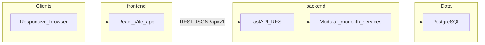
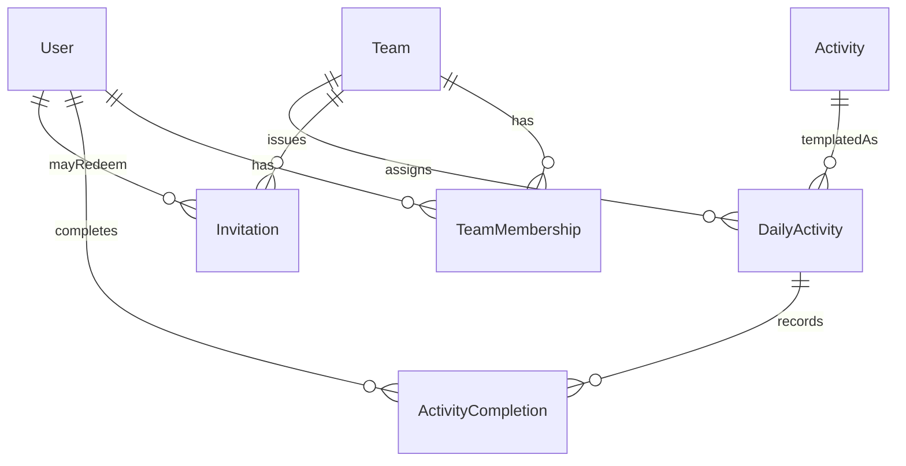

# Architecture

System-level design for Know Your Team. Package detail lives in [backend architecture](backend/ARCHITECTURE.md) and [frontend architecture](frontend/ARCHITECTURE.md).

This describes the intended MVP. Application code is not in the repository yet.

## Goals and constraints

- **Modular monolith.** One backend process with clear module boundaries. Microservices are unnecessary for the first release.
- **Simple until usage demands more.** Frontend talks to FastAPI over REST. The API validates, authorises, applies rules, and persists to PostgreSQL.
- **Privacy by default.** Personal disclosures are voluntary and never automatically shared with managers.
- **Deterministic daily assignment.** Every member of a team sees the same featured activity for that team's local date.

## System context

The product is a responsive browser app and a REST API. Frontend and API may be deployed separately if that stays simpler. PostgreSQL is the system of record. Configuration comes from environment variables.

## Backend modules

Names only; see [backend architecture](backend/ARCHITECTURE.md) for behaviour.

- Authentication and users
- Teams and memberships
- Invitations
- Activity library
- Daily assignment
- Completion tracking
- Team progress
- Administrative operations

## Frontend feature modules

Names only; see [frontend architecture](frontend/ARCHITECTURE.md) for screens and data flow.

- Auth
- Teams
- Activities
- Progress

## Core entities

| Entity | Purpose |
|--------|---------|
| **User** | An individual using the app |
| **Team** | A workspace for a company or group, including timezone |
| **TeamMembership** | Links a user to a team with a role and status |
| **Invitation** | A controlled invitation to join a team |
| **Activity** | A reusable template: title, instructions, category, duration |
| **DailyActivity** | An activity assigned to a team for a specific date |
| **ActivityCompletion** | A user's completion of an assigned activity |

Optional responses or reflections are modelled separately from completion records, with their own privacy permissions. Completing an activity is not consent to share an answer.

## Request flow

1. The UI calls `/api/v1/...`.
2. The API authenticates the caller.
3. The API authorises team membership and role.
4. Input is validated with Pydantic.
5. Business rules run in services.
6. State is persisted to PostgreSQL.

Auth and invitation endpoints are rate limited. Invitation tokens support expiry, revocation, and other access controls.

## Daily assignment contract

Assignment is deterministic and consistent for every member of a team.

1. Determine the team's configured timezone.
2. Work out the current local date for that team.
3. Select one eligible activity.
4. Create or retrieve the assignment for that team and date.
5. Return the same activity to all members.
6. Record completions against that assignment.
7. Prevent duplicate assignments and duplicate completions.

A unique constraint on `(team, date)` prevents multiple assignments for the same day. The MVP may use simple rotation or a curated schedule, and avoids repeating recent activities where enough content exists. Completions are idempotent: repeating complete must not create duplicate records.

## Roles

| Role | Intent |
|------|--------|
| **Team member** | View and complete or skip today's activity, view team progress and history, manage a basic profile, leave a team |
| **Team administrator** | Create and configure a team, invite and remove members, view team-level participation summaries, manage basic workspace settings |
| **Platform administrator** | Operational role for the activity library and operational issues, not an end-user product feature |

Administrator access does not grant access to private employee responses or personal disclosures.

## Proposed API surface

Names are proposed until an OpenAPI specification exists.

**Authentication and users**

- `POST /api/v1/auth/register`
- `POST /api/v1/auth/login`
- `GET /api/v1/users/me`
- `PATCH /api/v1/users/me`

**Teams**

- `POST /api/v1/teams`
- `GET /api/v1/teams`
- `GET /api/v1/teams/{team_id}`
- `GET /api/v1/teams/{team_id}/members`
- `POST /api/v1/teams/{team_id}/invitations`
- `POST /api/v1/teams/join`
- `DELETE /api/v1/teams/{team_id}/members/{user_id}`

**Activities**

- `GET /api/v1/teams/{team_id}/daily-activity`
- `GET /api/v1/teams/{team_id}/activities/history`
- `POST /api/v1/teams/{team_id}/daily-activity/complete`
- `POST /api/v1/teams/{team_id}/daily-activity/skip`

**Team progress**

- `GET /api/v1/teams/{team_id}/progress`
- `GET /api/v1/teams/{team_id}/progress/history`

All endpoints enforce team membership, role permissions, input validation, and rate limits.

## Security and privacy boundaries

- Collect only what is needed to operate the product.
- Do not automatically publish personal answers.
- Do not expose sensitive responses through administrator dashboards.
- Avoid individual participation rankings by default.
- Protect invitation tokens and session credentials (expiry, revocation, rate limits).
- Completing an activity and consenting to share a response are separate actions.

## Testing and deployment intent

- API integration tests, including permission boundaries, timezone-aware assignment, and duplicate-completion handling.
- Browser end-to-end tests for critical journeys once the UI exists.
- Frontend and API deployed separately if that stays simpler; managed PostgreSQL; configuration in environment variables; secrets in a secret manager.

## Out of scope for MVP architecture

- Microservices and message queues
- Native apps
- Slack or Microsoft Teams integrations
- Enterprise SSO
- Billing and subscription management
- Direct messaging, chat, or video
- Employee performance management or HR analytics
